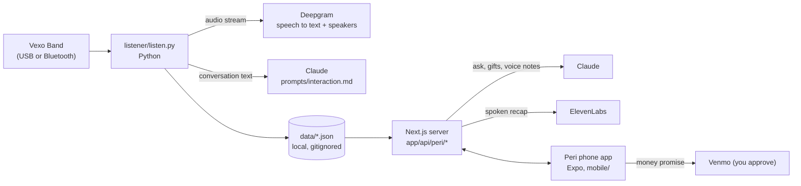

# Peri

**Peri hears the promises you make and helps you keep them, so the people you care about stay in your orbit.**

The name comes from *perigee*, the point where an orbit comes closest. A Vexo Band listens for
commitments in everyday conversation ("I'll send you $120 tonight", "your birthday's Saturday,
right?"). Peri files each one under the right person as **money, gift, task or plan**, puts that
person in your **orbit**, and helps you keep the promise with reminders, real-time
recommendations in the chat based on the promise itself (recipes for "make a sandwich", places
for "plan a trip to Hawaii", gift ideas for "get a soccer gift") and, for money, a Venmo payment
that Peri fills in and you authorize in the Venmo app.

Built at VexoHacks (Y Combinator, San Francisco), November 2026.

---

## Contents

- [What it does](#what-it-does)
- [How it works](#how-it-works)
- [Repository layout](#repository-layout)
- [Run it](#run-it)
- [Environment variables](#environment-variables)
- [Server API](#server-api)
- [Data and privacy](#data-and-privacy)
- [Troubleshooting](#troubleshooting)
- [Limitations](#limitations)
- [Team](#team)

## What it does

- **Always-on listening.** The band records non-stop. Speech is split by voice, cut into
  conversations by silence, and each conversation is summarized by Claude.
- **Promises, sorted.** Anything you commit to becomes a promise with a type
  (money / gift / task / plan), a person, an amount and a due time. Shared "we'll..." plans and
  promises to people who aren't in the room are caught too.
- **Your orbit.** You sit at the center; people orbit on three rings (inner, middle, outer).
  Keeping promises keeps people close; going quiet lets them drift outward, which Peri treats
  as a gentle nudge, never as guilt.
- **Hold the mic.** No band? Hold the mic button and say (or type) a promise; Peri sorts it.
- **Ask Peri.** Suggestions and a chat that knows what you've talked about with each person.
- **Keep it.** Gift ideas from what someone has mentioned, a spoken recap (ElevenLabs), and
  money promises open Venmo with the amount and note filled in. You approve the payment in Venmo;
  Peri never moves money on its own.
- **Voices that learn.** Voiceprints remember who is speaking once you name them.

### Screens (phone app, `mobile/src/app/`)

| Screen | File | What it shows |
|---|---|---|
| Welcome | `welcome.tsx` | Connect your band, import contacts |
| My orbit | `index.tsx` | Animated rings of people; today's and later promises (drag to reorder, swipe to delete, tick to keep) |
| Contacts | `contacts.tsx` | People sorted by open promises, phone contacts tab, merge duplicates |
| Person | `person/[id].tsx` | Stats, recaps, open and kept promises, circles, orbit choice, rename |
| Promise | `promise/[id].tsx` | One promise: edit who / what / when, get ideas from Peri |
| Hold mic | `mic.tsx` | Speak or type a promise; Peri sorts it into one or more promises |
| Ask Peri | `ask.tsx` | Suggestions and chat |
| Circles | `circles.tsx` | Family, Friends, Work, School, plus your own; pastel colors |
| Gift ideas | `gifts/[id].tsx` | Ideas based on what the person mentioned |
| Places | `places/[id].tsx` | Places you and someone were, as mentioned in conversation (the band has no GPS) |
| Transfer, then Kept | `transfer/[id].tsx`, `kept/[id].tsx` | Opens Venmo prefilled; then marks the promise kept |
| Band | `band.tsx` | Listening status, pause toggle, privacy promises |

## How it works



There are three parts, and they talk only through local files and HTTP:

1. **Band listener** (`listener/`, Python). Connects to the band, streams audio to Deepgram for
   transcription with speaker labels, matches voices against saved voiceprints, cuts the stream
   into conversations after `SILENCE_GAP` seconds of silence, and asks Claude for a title,
   summary, speaker names and promises. Results go to `data/interactions.json` and
   `data/promises.json`. The band LED shows its state (dim white idle, purple thinking, green
   saved, red error).
2. **Server** (repo root, Next.js). Reads those files and serves JSON to the phone app under
   `/api/peri/*`. It also makes the Claude calls that need a fresh answer (Ask Peri, gift ideas,
   "about" cards, hold-mic voice notes) and caches each answer by its input in `data/cache/`.
   API keys live only here. It also has a few debug pages for the band: `/live`, `/voices` and
   `/interactions/[id]`.
3. **Phone app** (`mobile/`, Expo + Expo Router). The Peri UI. It finds the server by itself:
   `EXPO_PUBLIC_PERI_SERVER` if set, otherwise the same machine that serves the Expo bundle, on
   port 3000.

Model: `claude-opus-5-5` (set in `lib/claude.ts` and `listener/config.py`).

## Repository layout

```
app/                 Next.js server: API routes (app/api/) and band debug pages (live, voices, interactions)
  api/peri/          Everything the phone app calls (people, promises, circles, ask, gifts, recap, band...)
  api/voice-todo/    Hold-mic: audio or text -> Deepgram -> Claude -> promises
lib/                 Server logic: peri.ts (app data), interactions.ts, claude.ts (cached structured calls)
listener/            Python band listener: listen.py, diarize.py, voiceprints.py, summarize.py, config.py
mobile/              Expo app (the Peri UI)
  src/app/           One file per screen (Expo Router)
  src/components/    Orbit, sheets, pickers, swipe and drag lists
  src/data/          api.ts (server client), store.tsx (app state), types.ts
prompts/             Claude system prompts (interaction.md is what the listener uses)
data/                Local data written by the listener and server. Only interactions.sample.json is committed
design/screens/      Design reference for each screen (*.dc.html)
docs/                RUN-PERI.md (run guide), DESIGN.md, PLAN.md, DEMO.md, COLLAB.md, PROGRESS.md
middleware.ts        Allows the Expo web preview (localhost:8081) to call the API
```

## Run it

### Prerequisites

- Node.js 20 or newer and npm
- For the band listener only: Python 3.10+ and a wearable (or use `--sim` / `--say`)
- API keys (see [Environment variables](#environment-variables)). Without keys the app still
  opens and shows empty or sample data, but AI features return an error.

### 1. Install

```bash
git clone https://github.com/calliehou/AI-wearable-hackathon
cd AI-wearable-hackathon
npm install                 # server
cd mobile && npm install    # phone app
cd ..
cp .env.example .env        # then fill in the keys; never commit .env
```

### 2. Start the server (terminal 1, repo root)

```bash
npm run dev                 # http://localhost:3000
```

Check it: `curl http://localhost:3000/api/peri` should return JSON with `people`, `todos`,
`circles` and `band`.

### 3. Start the phone app (terminal 2)

```bash
cd mobile
npx expo start              # scan the QR code with Expo Go
# or, in a desktop browser:
npx expo start --web        # http://localhost:8081
```

The app starts empty. Without a band you can add promises with the mic button (hold and speak,
or "Type it instead") and use Ask Peri, gift ideas, circles and the rest.

### 4. Optional: the band listener (terminal 3)

```bash
python3 -m venv .venv
.venv/bin/pip install -r listener/requirements.txt
git clone https://github.com/VexoAI-Org/vexo-open-kit.git     # gitignored, stays local
```

Set your band number (`BAND`) and your name (`WEARER`) in `listener/config.py`, then run one of:

```bash
.venv/bin/python listener/listen.py            # band on the USB cable
.venv/bin/python listener/listen.py --ble      # band over Bluetooth (double-tap it first)
.venv/bin/python listener/listen.py --sim      # pretend band reading the kit's sample voice
.venv/bin/python listener/listen.py --say "0: Hi, I'm Sam\n1: Hi Sam"   # typed, no band, no Deepgram
```

Options: `--gap SECONDS` (silence that ends a conversation), `--max SECONDS` (longest one).
A double-tap on the band ends the current conversation right away.

### Use another computer's band data

If the band runs on a teammate's Mac, you don't need any keys. On that Mac, run the listener
and `npm run dev`, and find its IP with `ipconfig getifaddr en0`. Then on your laptop:

```bash
cd mobile
EXPO_PUBLIC_PERI_SERVER=http://<that Mac's IP>:3000 npx expo start
```

More detail: [`docs/RUN-PERI.md`](docs/RUN-PERI.md).

### Commands

| Where | Command | What it does |
|---|---|---|
| root | `npm run dev` | Server with hot reload on port 3000 |
| root | `npm run build` | Production build (run before merging to `main`) |
| root | `npm run lint` | ESLint |
| `mobile/` | `npx expo start` | Phone app via Expo Go |
| `mobile/` | `npm run web` | Phone app in the browser |
| `mobile/` | `npm run lint` | Expo lint |

## Environment variables

Put these in `.env` in the repo root. Both the Next.js server and the Python listener read it.
The phone app never sees these keys.

| Variable | Used by | Needed for |
|---|---|---|
| `ANTHROPIC_API_KEY` | server, listener | Summaries, promise sorting, Ask Peri, gift ideas |
| `DEEPGRAM_API_KEY` | server, listener | Speech to text with speaker labels (band and hold-mic) |
| `ELEVENLABS_API_KEY` | server | Spoken recap (optional) |
| `ELEVENLABS_VOICE_ID` | server | Recap voice (optional; defaults to ElevenLabs' example voice) |
| `EXPO_PUBLIC_PERI_SERVER` | phone app | Point the app at another computer's server (optional) |

`.env.example` also lists a few variables from the hackathon template (`ADAPTER_MODE`,
`VEXO_API_KEY`, weather and AQI keys) that the current code does not read.

## Server API

All routes are under `http://<server>:3000/api`. The phone app's client is
`mobile/src/data/api.ts`.

| Route | Purpose |
|---|---|
| `GET /peri` | Everything the home screen needs: people, promises, circles, suggestions, stats, band status |
| `/peri/promises`, `/peri/promises/[id]`, `/peri/promises/order` | Add, edit, keep, delete and reorder promises |
| `/peri/people/rename`, `/peri/people/orbit` | Rename a person, choose their ring |
| `/peri/circles`, `/peri/circles/members` | Create and recolor circles, add people to them |
| `/peri/about` | The "About" memory card and "Places together" for a person |
| `/peri/ask` | Ask Peri suggestions and chat |
| `/peri/gifts` | Gift ideas for a person |
| `/peri/recap`, `/peri/recap/audio/[file]` | Short recap of a person, optionally spoken |
| `/peri/payee` | Save a person's payment username (Venmo) |
| `/peri/band` | Band status and the pause toggle |
| `/peri/voices` | Name a voice the band heard |
| `POST /voice-todo` | Hold-mic: recording or typed text in, promises out |
| `/interactions`, `/interactions/[id]`, `/live`, `/live/name` | Raw conversations and the live view (band debug pages) |

## Data and privacy

- **Audio is never stored.** It is streamed to Deepgram and only the text is kept.
- **Everything stays local.** Conversations, voiceprints, promises, circles and caches are
  written to `data/` on the computer running the listener and are **gitignored**. Only
  `data/interactions.sample.json` is committed, so screens have something to show before the
  first recording.
- **Other people's words are summarized, not quoted.** Only your own words appear as quotes.
- **Money never moves without you.** Peri opens Venmo prefilled; you confirm the payment in Venmo.
- Keys stay on the server in `.env`, which is never committed.
- Real contact exports belong in `data/raw/`, which is gitignored too.

## Troubleshooting

| Symptom | Fix |
|---|---|
| App says "Can't reach the Mac" | Is `npm run dev` running? Are phone and computer on the same Wi-Fi? Try `EXPO_PUBLIC_PERI_SERVER=http://<IP>:3000` |
| Web preview gets CORS errors | Open the preview at `http://localhost:8081` (the only origins `middleware.ts` allows) |
| `No ANTHROPIC_API_KEY` from the listener | Put the key in `.env` in the repo root (not `.env.local`) |
| Listener can't import `vexo_open` | Clone `vexo-open-kit` into the repo root (step 4) |
| Bluetooth errors on start | The listener keeps retrying; double-tap the band and allow Bluetooth for your terminal |
| `npm run dev` says port 3000 is in use | Another server is running; stop it, since the app expects port 3000 |

## Limitations

- Built in a hackathon: there is no database or login, and data is local JSON on one computer.
- The server must be on the same network as the phone; it isn't deployed.
- Voice recognition is best-effort; a new voice may need to be named once on the Voices page.
- Payments go only through Venmo, and only as a prefilled link that you approve.

## Team

| Name | Role | Email |
|---|---|---|
| **Callie Hou** | Design engineering, UI and pipeline | [hcallie@stanford.edu](mailto:hcallie@stanford.edu) |
| **Mapa Garzon** | Business, data, band integration | [mpgarzon@stanford.edu](mailto:mpgarzon@stanford.edu) |

Questions, ideas or want to try Peri? Feel free to contact us.

Built at VexoHacks, Y Combinator, San Francisco, November 2026.
